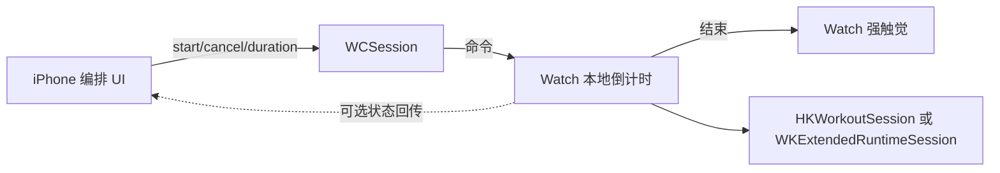

# Apple Watch 组间休息计时 — 可行性结论

**结论：可行。** 面向个人使用的原生 iPhone + Apple Watch「组间休息计时 + 锁屏/后台准时提醒」，前提是**倒计时在 Watch 本地运行**，不以 iPhone 推送或延迟的 WatchConnectivity 消息作为到点主路径。

## 架构原则

| 角色 | 职责 |
|------|------|
| iPhone | 编排：选预设、发起/取消休息、展示状态 |
| Apple Watch | **倒计时事实源**：本地计时、结束强触觉、可选 UI |
| 通道 | WatchConnectivity：仅传 start / cancel / duration（及可选 set index） |
| 会话 | 优先 `HKWorkoutSession`（真实训练上下文）；否则 `WKExtendedRuntimeSession`（有时长/用途限制） |

**明确不做（作主路径）：**

- 依赖 iPhone 本地通知镜像到 Watch 来「到点」
- 依赖晚到的 `WCSession`「time’s up」消息驱动触觉

## 准时性预期

| 场景 | 预期 | 说明 |
|------|------|------|
| Watch 本地 Timer + 活跃会话 | ≈1s | 主路径；锁屏、垂腕再抬腕也应准时 |
| iPhone → Watch 仅通知「开始」 | 可有数百 ms～数秒延迟 | 只影响**启动**，不影响结束时刻（结束按 Watch 本地 deadline） |
| 勿扰 / 剧院模式 | 可能抑制触觉或声音 | 已知限制，验收时记录，不作为 MVP 必过项 |
| 短休息（60–120s） | 本地路径足够 | 无需长后台调度技巧 |

## 技术选型（MVP）

- **UI**：SwiftUI，iOS + watchOS 双 target
- **通信**：`WCSession`（应用层命令封装，见 Demo `WatchConnectivityBridge`）
- **反馈**：Watch `WKInterfaceDevice` / `CHHaptic` 等强触觉（Demo 中 stub）
- **存储**：先本地（UserDefaults / 简单模型）；不做云同步
- **HealthKit**：仅在使用真实 `HKWorkoutSession` 时引入；否则可先用 Extended Runtime 验证准时性

## 风险与前置条件

1. **API 用途 / 审核**：`HKWorkoutSession`、Extended Runtime 须符合用途声明；个人自用可不上架，真机仍需正确 capability。
2. **耗电**：Workout / Extended 会话会抬高功耗；MVP 仅在休息段或整次训练内保持会话。
3. **工具链**：需要 Mac + Xcode + **真机** iPhone/Watch；模拟器无法完整验证锁屏/垂腕触觉。Cloud Agent / Linux 通常无法编译 watchOS。
4. **仓库**：源码骨架已落在本仓库 `RestTimer/`；真机构建与验收请在 Mac 完成。

## 首版验收清单

详见独立清单：[mvp-acceptance.md](./mvp-acceptance.md)。摘要：

1. iPhone：预设 60 / 90 / 120s，一键开始休息  
2. Watch：本地倒计时 UI + 结束强触觉  
3. 锁屏 / 垂腕再抬腕：触觉仍准时  
4. 可取消 / 提前结束以便下一组  

## Demo 骨架位置

仓库内 [`RestTimer/`](../RestTimer/) — 源码可加入 Xcode 双 target；见 [`RestTimer/README.md`](../RestTimer/README.md)。可选根目录 [`project.yml`](../project.yml) 供 Mac 上 XcodeGen 生成工程。
